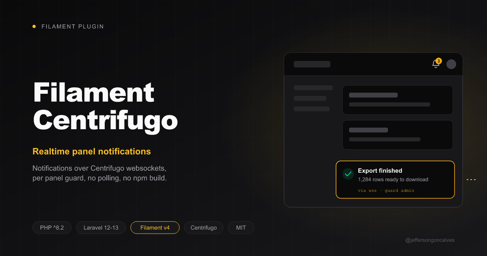

<div class="filament-hidden">



</div>

# Filament Centrifugo

[](https://packagist.org/packages/jeffersongoncalves/filament-centrifugo)
[](https://github.com/jeffersongoncalves/filament-centrifugo/actions?query=workflow%3ATests+branch%3A1.x)
[](https://github.com/jeffersongoncalves/filament-centrifugo/actions?query=workflow%3A%22Fix+PHP+code+styling%22+branch%3A1.x)
[](https://packagist.org/packages/jeffersongoncalves/filament-centrifugo)
[](LICENSE.md)

Realtime Filament notifications over [Centrifugo](https://centrifugal.dev) websockets, built on [`jeffersongoncalves/laravel-centrifugo`](https://github.com/jeffersongoncalves/laravel-centrifugo). The plugin:

- injects a Laravel Echo stand-in into the panel for logged-in users — Filament's database and broadcast notifications arrive over the websocket, no Pusher protocol, no npm build;
- connects as the **panel's auth guard** (an `admin` panel connects as the admin, even with a `web` user logged in on the same browser);
- turns database-notification polling off, and refreshes the bell live for every stored Filament notification — `sendToDatabase()` works with or without `isEventDispatched: true`.

## Compatibility

| Package Version | Filament Version |
|-----------------|------------------|
| [1.x](https://github.com/jeffersongoncalves/filament-centrifugo/tree/1.x) | 3.x |
| [2.x](https://github.com/jeffersongoncalves/filament-centrifugo/tree/2.x) | 4.x |
| [3.x](https://github.com/jeffersongoncalves/filament-centrifugo/tree/3.x) | 5.x |

Requires Laravel 12 or 13 (from `laravel-centrifugo`).

## Installation

You can install the package via composer:

```bash
composer require jeffersongoncalves/filament-centrifugo
```

Configure Centrifugo and the `.env` as described in [laravel-centrifugo](https://github.com/jeffersongoncalves/laravel-centrifugo#configuration):

```dotenv
BROADCAST_CONNECTION=centrifugo
CENTRIFUGO_API_URL=http://127.0.0.1:8000/api
CENTRIFUGO_API_KEY=<API_KEY>
CENTRIFUGO_TOKEN_HMAC_SECRET=<SECRET>
CENTRIFUGO_URL=https://ws.your-app.com
```

## Usage

Register the plugin in your panel:

```php
use JeffersonGoncalves\Filament\Centrifugo\CentrifugoPlugin;

public function panel(Panel $panel): Panel
{
    return $panel
        ->authGuard('admin')
        ->databaseNotifications()
        ->plugin(CentrifugoPlugin::make());
}
```

Enable Laravel's broadcasting auth route and authorize the notification channel on the panel's guard:

```php
// bootstrap/app.php
->withBroadcasting(__DIR__.'/../routes/channels.php')

// routes/channels.php
Broadcast::channel(
    'App.Models.Admin.{id}',
    fn ($admin, $id) => (string) $admin->id === $id,
    ['guards' => ['admin']],
);
```

Send notifications as usual — the bell refreshes live:

```php
Notification::make()
    ->title('Export finished')
    ->sendToDatabase($admin);

// or a toast pushed straight to the open panel
Notification::make()->title('Saved')->broadcast($admin);
```

Broadcast events are queued — run a queue worker.

### Keep polling

```php
CentrifugoPlugin::make()->disablePolling(false)
```

## Testing

```bash
composer test
```

## Changelog

Please see [CHANGELOG](CHANGELOG.md) for more information on what has changed recently.

## Contributing

Please see [CONTRIBUTING](.github/CONTRIBUTING.md) for details.

## Security Vulnerabilities

Please review [our security policy](../../security/policy) on how to report security vulnerabilities.

## Credits

- [Jefferson Gonçalves](https://github.com/jeffersongoncalves)
- [All Contributors](../../contributors)

## License

The MIT License (MIT). Please see [License File](LICENSE.md) for more information.
